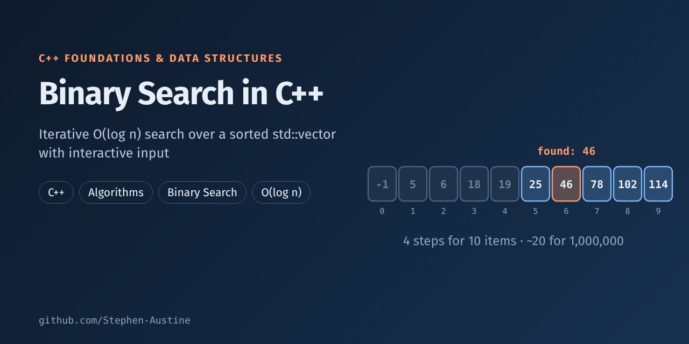
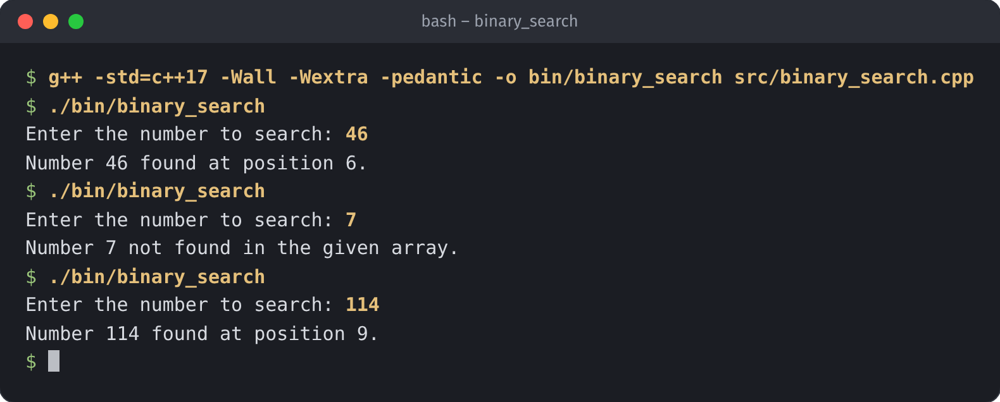
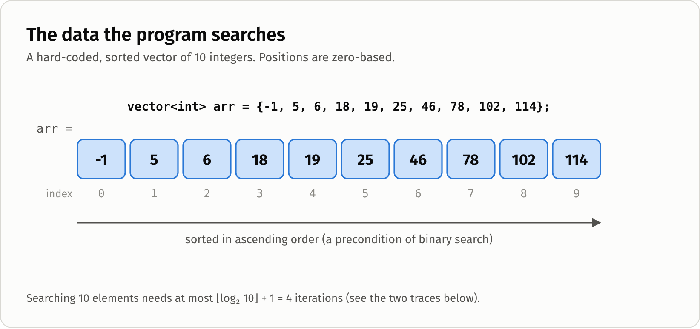
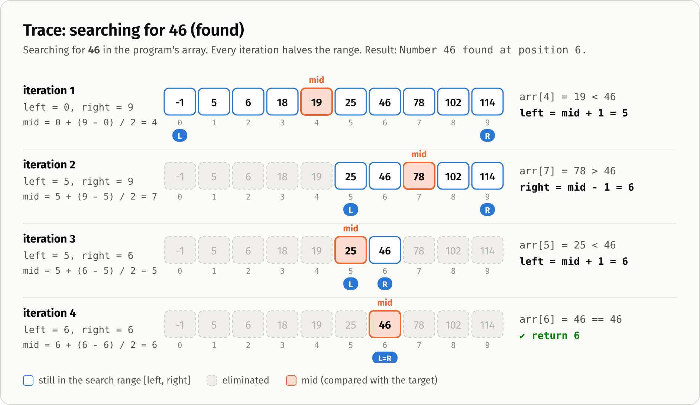
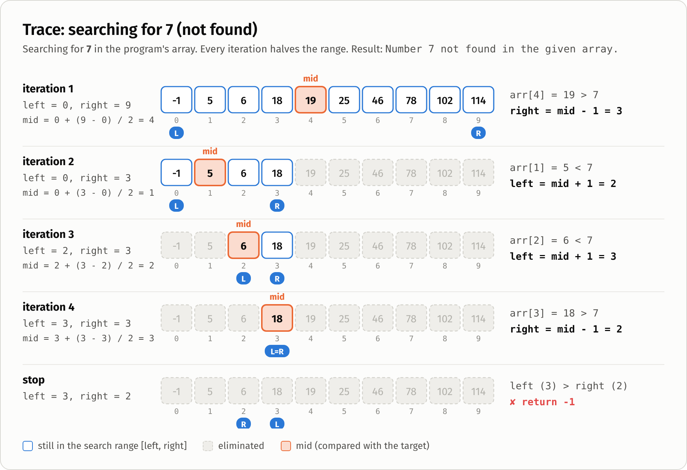
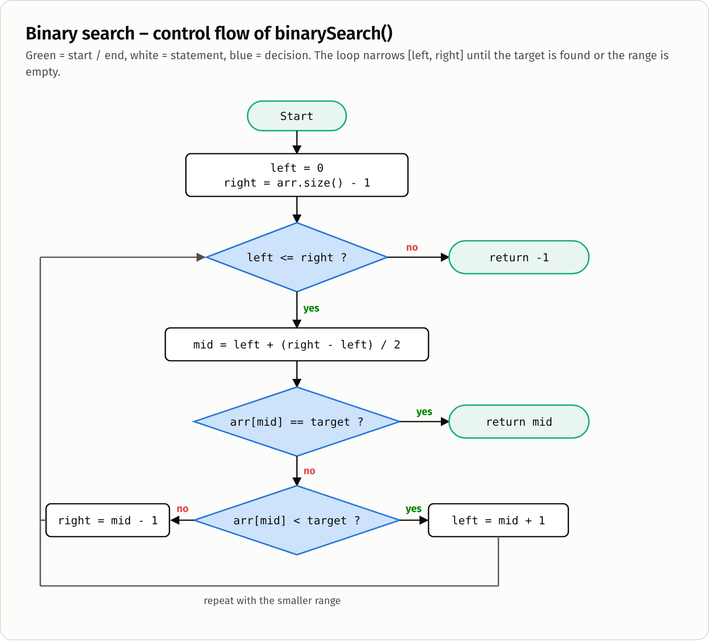
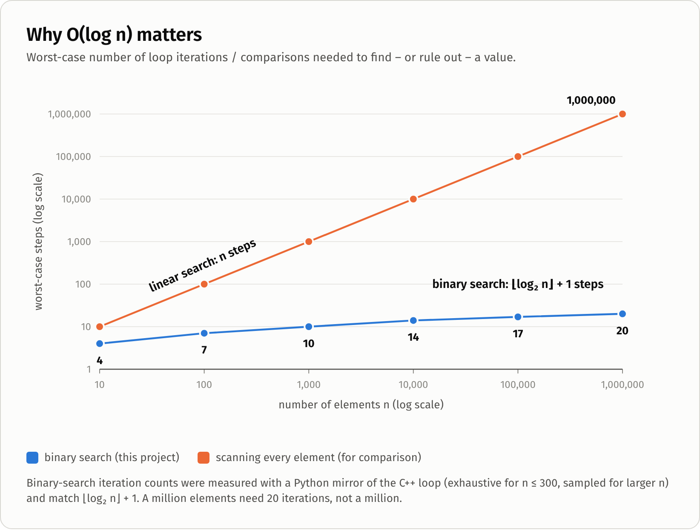

<div align="center">



# C++ Binary Search on a Sorted Vector – Interactive Console Program

**An iterative binary-search implementation in modern C++: type a number, and the program finds its position in a sorted `std::vector<int>` in O(log n) time – with step-by-step traces, a complexity chart, a flowchart, tests, and a candid list of pitfalls.**

[](https://github.com/Stephen-Austine/CPP-Binary-Search-on-Sorted-Vector-with-Interactive-User-Input/actions/workflows/ci.yml)


</div>

---

## Table of contents

1. [Overview](#1-overview)
2. [What you will learn](#2-what-you-will-learn)
3. [Demo](#3-demo)
4. [How binary search works](#4-how-binary-search-works)
5. [Worked examples](#5-worked-examples)
6. [Project structure](#6-project-structure)
7. [Getting started](#7-getting-started)
8. [The source code, explained](#8-the-source-code-explained)
9. [Flowchart](#9-flowchart)
10. [Complexity analysis](#10-complexity-analysis)
11. [Testing](#11-testing)
12. [Known limitations and pitfalls](#12-known-limitations-and-pitfalls)
13. [Ideas for improving the program](#13-ideas-for-improving-the-program)
14. [Changes made when preparing this repository](#14-changes-made-when-preparing-this-repository)
15. [Practice exercises](#15-practice-exercises)
16. [FAQ](#16-faq)
17. [Related projects](#17-related-projects)
18. [License and author](#18-license-and-author)

---

## 1. Overview

**Binary search** finds a value in a **sorted** collection by repeatedly cutting the search range in half. Instead of looking at elements one by one (linear search, O(n)), it compares the target with the *middle* element and throws away the half that cannot contain it. That makes it O(log n): searching **a million sorted items takes about 20 comparisons**.

This program:

1. Holds a hard-coded sorted vector: `{-1, 5, 6, 18, 19, 25, 46, 78, 102, 114}`.
2. Asks you for a number.
3. Calls `binarySearch(arr, target)`, which returns the **zero-based index** of the number, or `-1` if it is absent.
4. Prints either `Number N found at position P.` or `Number N not found in the given array.`

### Highlights

- Pure standard C++ – `<iostream>` and `<vector>` only.
- **Iterative** implementation (no recursion, O(1) extra space).
- Uses the overflow-safe midpoint `left + (right - left) / 2`.
- Takes the vector by `const` reference – no copy, no accidental modification.
- Builds warning-free with `-Wall -Wextra -pedantic` on **C++11, 14, 17 and 20**, with both **g++** and **clang++**.
- 16 automated input/output tests (every element found at the right index; six "not found" cases).
- Illustrated with two step-by-step traces, a complexity chart and a flowchart.

---

## 2. What you will learn

- The **divide-and-conquer** idea and why halving gives a logarithmic running time.
- The **loop invariant** of binary search: *if the target is in the array, it is inside `[left, right]`*.
- Why the midpoint is written `left + (right - left) / 2` instead of `(left + right) / 2`.
- How to pass a container to a function efficiently with `const vector<int>&`.
- Why a **sorted** input is a precondition – and what goes wrong without it.
- How `std::cin` behaves on unexpected input (decimals, letters, huge numbers).
- How to test an interactive program by feeding it standard input.

---

## 3. Demo

Three runs: a value in the middle (`46`), a value that is not present (`7`) and the last element (`114`).

<p align="center">
  
</p>

> The screenshot is a real capture of the compiled program running in a terminal.

```text
Enter the number to search: 46
Number 46 found at position 6.

Enter the number to search: 7
Number 7 not found in the given array.

Enter the number to search: 114
Number 114 found at position 9.
```

### The data

<p align="center">
  
</p>

| Index | 0 | 1 | 2 | 3 | 4 | 5 | 6 | 7 | 8 | 9 |
|---|---|---|---|---|---|---|---|---|---|---|
| Value | -1 | 5 | 6 | 18 | 19 | 25 | 46 | 78 | 102 | 114 |

Positions are **zero-based**: the first element is at position `0`.

---

## 4. How binary search works

### 4.1 The algorithm

Keep two markers, `left` and `right`, that bound the part of the array that could still contain the target. Initially that is the whole array.

```text
left  = 0
right = size - 1

while left <= right:
    mid = left + (right - left) / 2
    if arr[mid] == target:  return mid            # found
    if arr[mid] <  target:  left  = mid + 1       # target must be in the upper half
    else:                   right = mid - 1       # target must be in the lower half

return -1                                         # range is empty: not present
```

### 4.2 Why it works

- The array is sorted, so everything **left** of `mid` is ≤ `arr[mid]` and everything **right** of it is ≥ `arr[mid]`.
- If `arr[mid] < target`, then `mid` *and everything to its left* is too small – so the new range starts at `mid + 1`.
- If `arr[mid] > target`, then `mid` and everything to its right is too big – so the new range ends at `mid - 1`.
- Every iteration at least halves the range, and `mid` itself is always removed, so the loop must end.

### 4.3 The loop invariant

> *At the start of every iteration: if `target` is in the array, its index is in `[left, right]`.*

It holds at the start (the range is the whole array), it is preserved by each update (we only discard elements that cannot be the target), and when the loop ends with `left > right` the range is empty – so the target cannot be present.

### 4.4 Why `left + (right - left) / 2`?

`(left + right) / 2` computes `left + right` first. For very large indices that sum can exceed the largest `int` and **overflow** (undefined behaviour for signed integers). `left + (right - left) / 2` produces the same midpoint but never forms a number larger than `right`. For a 10-element vector it makes no practical difference – but it is the habit worth learning, and it is a famous real-world bug that went unnoticed in widely used library code for years.

---

## 5. Worked examples

### 5.1 Target found: 46

<p align="center">
  
</p>

| Iteration | `left` | `right` | `mid` | `arr[mid]` | Comparison | Action |
|---|---|---|---|---|---|---|
| 1 | 0 | 9 | 4 | 19 | 19 < 46 | `left = mid + 1 = 5` |
| 2 | 5 | 9 | 7 | 78 | 78 > 46 | `right = mid - 1 = 6` |
| 3 | 5 | 6 | 5 | 25 | 25 < 46 | `left = mid + 1 = 6` |
| 4 | 6 | 6 | 6 | 46 | 46 == 46 | **return 6** |

Four comparisons instead of the seven a linear scan needs to reach index 6.

### 5.2 Target missing: 7

<p align="center">
  
</p>

| Iteration | `left` | `right` | `mid` | `arr[mid]` | Comparison | Action |
|---|---|---|---|---|---|---|
| 1 | 0 | 9 | 4 | 19 | 19 > 7 | `right = mid - 1 = 3` |
| 2 | 0 | 3 | 1 | 5 | 5 < 7 | `left = mid + 1 = 2` |
| 3 | 2 | 3 | 2 | 6 | 6 < 7 | `left = mid + 1 = 3` |
| 4 | 3 | 3 | 3 | 18 | 18 > 7 | `right = mid - 1 = 2` |
| stop | 3 | 2 | – | – | `left > right` | **return -1** |

The range shrinks until it is **empty** (`left = 3 > right = 2`). 7 would have to sit between 6 (index 2) and 18 (index 3), and nothing lives there.

> Both traces were produced by a model of the C++ loop that was **checked against the real compiled program** for 16 different targets (every element plus several missing values) before the figures were drawn.

---

## 6. Project structure

```text
CPP-Binary-Search-on-Sorted-Vector-with-Interactive-User-Input/
├── src/
│   └── binary_search.cpp         # binarySearch() + interactive main()
├── tests/
│   └── run_tests.sh              # black-box tests: feeds stdin, compares stdout (16 checks)
├── docs/
│   └── images/                   # every figure used in this README
├── .github/
│   └── workflows/ci.yml          # builds + tests on C++11/14/17/20
├── Makefile                      # make | make run | make test | make clean
├── .gitignore
├── LICENSE                       # MIT
└── README.md
```

---

## 7. Getting started

### 7.1 Prerequisites

Any C++11-or-newer compiler:

| Platform | How to get one |
|---|---|
| Linux (Debian/Ubuntu) | `sudo apt install build-essential` |
| macOS | `xcode-select --install` (provides `clang++`) |
| Windows | [MSYS2 / MinGW-w64](https://www.msys2.org/) for `g++`, or Visual Studio's C++ workload |

The test script needs a Bash shell (Linux, macOS, WSL or Git Bash). The program itself does not.

### 7.2 Clone

```bash
git clone https://github.com/Stephen-Austine/CPP-Binary-Search-on-Sorted-Vector-with-Interactive-User-Input.git
cd CPP-Binary-Search-on-Sorted-Vector-with-Interactive-User-Input
```

### 7.3 Build and run with `make`

```bash
make          # compiles src/binary_search.cpp  ->  bin/binary_search
make run      # builds (if needed) and starts the interactive program
make test     # builds and runs the 16 automated tests
make clean    # removes bin/
```

Use a different compiler or standard without editing anything:

```bash
make CXX=clang++
make CXXFLAGS="-std=c++11 -Wall -Wextra -pedantic -O2"
```

### 7.4 Build and run without `make`

```bash
mkdir -p bin
g++ -std=c++17 -Wall -Wextra -pedantic -o bin/binary_search src/binary_search.cpp
./bin/binary_search
```

On Windows (MinGW) the executable is `bin\binary_search.exe`. With the Visual Studio developer prompt the equivalent command is `cl /EHsc /std:c++17 src\binary_search.cpp` (the MSVC route has not been tested for this repository; g++ and clang++ have).

### 7.5 Non-interactive use

Because the program reads from standard input, you can script it:

```bash
echo 46 | ./bin/binary_search
# Enter the number to search: Number 46 found at position 6.
```

---

## 8. The source code, explained

Full file: [`src/binary_search.cpp`](src/binary_search.cpp)

```cpp
#include <iostream>
#include <vector>
using namespace std;

// The Function
int binarySearch(const vector<int>& arr, int target) {
    int left = 0;
    int right = arr.size() - 1;

    while (left <= right) {
        int mid = left + (right - left) / 2;

        // Check if is in the middle
        if (arr[mid] == target) {
            return mid; // Target found, return its position
        }
        // Check if is in the lower middle
        else if (arr[mid] < target) {
            left = mid + 1;
        }
        // Check if is in the upper middle
        else {
            right = mid - 1;
        }
    }

    return -1; // Not found
}

int main() {
    // The array
    vector<int> arr = {-1, 5, 6, 18, 19, 25, 46, 78, 102, 114};

    // Number
    int target;
    cout << "Enter the number to search: ";
    cin >> target;

    // Binary search
    int position = binarySearch(arr, target);

    // Result
    if (position != -1) {
        cout << "Number " << target << " found at position " << position << "." << endl;
    } else {
        cout << "Number " << target << " not found in the given array." << endl;
    }

    return 0;
}
```

### 8.1 `binarySearch` line-by-line

| Code | Explanation |
|---|---|
| `int binarySearch(const vector<int>& arr, int target)` | Takes the vector **by `const` reference**: no copy is made (important for large vectors) and the function promises not to modify it. Returns an `int` index. |
| `int left = 0;` | Left boundary of the search range: the first index. |
| `int right = arr.size() - 1;` | Right boundary: the last index. `size()` returns an unsigned type; the result is converted to `int`. For an empty vector this gives `-1`, so the loop body never runs. |
| `while (left <= right)` | The range is non-empty while `left` has not passed `right`. Note **`<=`**, not `<`: a one-element range (`left == right`) must still be examined. |
| `int mid = left + (right - left) / 2;` | Overflow-safe midpoint; integer division rounds down, so with two candidates `mid` is the *left* one. |
| `if (arr[mid] == target) return mid;` | Success. Returns the index immediately. |
| `else if (arr[mid] < target) left = mid + 1;` | `arr[mid]` is too small, so the target (if present) is to the right. Skipping `mid` itself (`+ 1`) guarantees progress. |
| `else right = mid - 1;` | `arr[mid]` is too large, so the target (if present) is to the left. |
| `return -1;` | The loop ended with an empty range: not found. `-1` is a safe sentinel because valid indices are never negative. |

### 8.2 `main` line-by-line

| Code | Explanation |
|---|---|
| `vector<int> arr = {...};` | A sorted vector, initialised with a brace list (C++11). |
| `int target; cin >> target;` | Reads one integer from the keyboard. |
| `int position = binarySearch(arr, target);` | Runs the search. |
| `if (position != -1)` | Distinguishes "found" from "not found" using the sentinel. |
| `endl` | Writes a newline and flushes the stream. |

---

## 9. Flowchart

<p align="center">
  
</p>

The three-way comparison (`==`, `<`, otherwise `>`) either leaves the function (found) or shrinks the range and loops back to the `left <= right` test. The only other exit is the empty range, which returns `-1`.

---

## 10. Complexity analysis

| Measure | Value | Explanation |
|---|---|---|
| **Time – best case** | O(1) | The target happens to be the first midpoint (here: 19, at index 4) |
| **Time – worst / average** | **O(log n)** | The range is halved every iteration; at most ⌊log₂ n⌋ + 1 iterations |
| **Space** | **O(1)** | Three `int` variables, no recursion, no copy of the vector |

### How much faster than a linear scan?

<p align="center">
  
</p>

| Elements `n` | Linear scan (worst case) | Binary search (worst case) |
|---|---|---|
| 10 | 10 | **4** |
| 100 | 100 | **7** |
| 1,000 | 1,000 | **10** |
| 10,000 | 10,000 | **14** |
| 100,000 | 100,000 | **17** |
| 1,000,000 | 1,000,000 | **20** |

The binary-search column was **measured** by counting loop iterations of a model of this exact algorithm: exhaustively for every `n ≤ 300` and with random sampling for larger `n` – it always matched ⌊log₂ n⌋ + 1. Each time the data grows 1000×, binary search needs only about 10 more steps.

> **The catch:** binary search requires **sorted** data. If your data is unsorted, sorting costs O(n log n), so binary search pays off when you search *many times* in the same sorted data.

---

## 11. Testing

### 11.1 Running the tests

```bash
make test
```

Expected output:

```text
binary_search tests (array: -1 5 6 18 19 25 46 78 102 114)
  PASS  finds -1 at position 0
  PASS  finds 5 at position 1
  PASS  finds 6 at position 2
  PASS  finds 18 at position 3
  PASS  finds 19 at position 4
  PASS  finds 25 at position 5
  PASS  finds 46 at position 6
  PASS  finds 78 at position 7
  PASS  finds 102 at position 8
  PASS  finds 114 at position 9
  PASS  reports -50 as not found
  PASS  reports 0 as not found
  PASS  reports 7 as not found
  PASS  reports 20 as not found
  PASS  reports 103 as not found
  PASS  reports 200 as not found

Known limitation (not counted as failure):
  CONFIRMED  non-numeric input is silently treated as 0 (see README, Known limitations)
  CONFIRMED  decimal input 46.7 is silently truncated to 46

16 passed, 0 failed
```

### 11.2 How the tests work

`tests/run_tests.sh` is a *black-box* test: it pipes a number into the program's standard input and compares **the entire output** with the expected text, byte for byte (including the prompt).

```bash
check "finds 46 at position 6" "46\n" "Enter the number to search: Number 46 found at position 6.
"
```

### 11.3 Test design

| Group | Cases | Why it matters |
|---|---|---|
| Every element | 10 | Each index is hit at least once: first, last and every middle position |
| Below the range | `-50` | The loop must end with `right` falling below 0 |
| Inside the range, absent | `0`, `7`, `20` | Targets *between* two elements |
| Above the range | `103`, `200` | The loop must end with `left` passing the last index |

The two "known limitation" probes at the end are *reports*, not pass/fail tests: they confirm that the behaviour described in [section 12](#12-known-limitations-and-pitfalls) is real, and print `CHANGED` if a future edit alters it.

### 11.4 Continuous integration

`.github/workflows/ci.yml` runs `make test` on every push and pull request for C++11, 14, 17 and 20 with `-Wall -Wextra -pedantic`.

---

## 12. Known limitations and pitfalls

Every item below was checked by running the program or the function.

### 1. The data is hard-coded

The only thing the user supplies is the target. Changing the data means editing the source and recompiling.

### 2. The array **must** be sorted – or answers are wrong

Binary search never checks that its input is sorted. On unsorted data it can miss values that are present. Verified with the function on `{9, 1, 5}`:

| Search for | Result | Correct? |
|---|---|---|
| `1` | `1` | yes (by luck) |
| `9` | **`-1`** | **no – 9 is at index 0** |

### 3. Duplicates: you get *an* index, not the first or last

With several equal values, whichever copy the midpoints land on is returned. Verified:

| Vector | Target | Returned index |
|---|---|---|
| `{1, 2, 2, 2, 3}` | `2` | `2` (the middle copy) |
| `{7, 7, 7, 7}` | `7` | `1` |

(See [13.1](#131-first-occurrence-of-a-duplicate) for a variant that always returns the first.)

### 4. Weak input handling

`cin >> target` is not checked for failure, so unusual input is accepted silently:

| You type | What the program does |
|---|---|
| `46.7` | Reads `46` and ignores `.7` → *"Number 46 found at position 6."* |
| `46abc` | Reads `46`, ignores `abc` → *"Number 46 found at position 6."* |
| `abc` | Extraction fails, `target` becomes `0` → *"Number 0 not found…"* (not "invalid input") |
| `99999999999` | Out of `int` range → `target` becomes `2147483647` → *"Number 2147483647 not found…"* |

### 5. A narrowing conversion

`int right = arr.size() - 1;` converts an unsigned `size_t` to `int`. That is fine for 10 elements, but a vector with more than about two billion elements would not fit in an `int` index.

### 6. Positions are zero-based

`found at position 6` means the *seventh* element. Users who expect counting from 1 may be confused.

### 7. `int` only, one search per run

The function is not a template, and the program exits after a single query.

---

## 13. Ideas for improving the program

> These snippets are **suggestions**, not part of the repository's source. Each complete snippet was compiled with `g++ -std=c++17 -Wall -Wextra -pedantic` and run.

### 13.1 First occurrence of a duplicate

Instead of returning immediately on a match, remember it and keep searching the left half:

```cpp
#include <iostream>
#include <vector>

// Returns the index of the FIRST occurrence of target, or -1.
int firstIndexOf(const std::vector<int>& a, int target) {
    int lo = 0, hi = static_cast<int>(a.size()) - 1, ans = -1;
    while (lo <= hi) {
        int mid = lo + (hi - lo) / 2;
        if (a[mid] == target) { ans = mid; hi = mid - 1; }     // keep looking to the left
        else if (a[mid] < target) lo = mid + 1;
        else hi = mid - 1;
    }
    return ans;
}
int main() {
    std::vector<int> a = {1, 2, 2, 2, 3};
    std::cout << firstIndexOf(a, 2) << ' ' << firstIndexOf(a, 5) << '\n';   // prints: 1 -1
}
```

### 13.2 Use the standard library in real projects

```cpp
#include <algorithm>
#include <iostream>
#include <vector>

int main() {
    std::vector<int> a = {1, 2, 2, 2, 3};
    auto it = std::lower_bound(a.begin(), a.end(), 2);   // first element >= 2
    if (it != a.end() && *it == 2) std::cout << "first 2 at index " << (it - a.begin()) << '\n';
    std::cout << std::boolalpha << std::binary_search(a.begin(), a.end(), 3) << '\n';
}
// prints:
// first 2 at index 1
// true
```

`std::lower_bound`, `std::upper_bound`, `std::equal_range` and `std::binary_search` are tested, generic and work with any sorted range and comparator. Writing your own, as this project does, is for *learning how they work*.

### 13.3 Validate the input (fragment)

```cpp
int target;
if (!(cin >> target)) {                      // true when the extraction failed
    cerr << "Please enter a whole number.\n";
    return 1;
}
```

### 13.4 More ideas

- Read the vector from a file or from the command line.
- Loop until the user types a quit command, so many searches can be done in one run.
- Print the iteration trace (`left`, `right`, `mid`) behind a `--verbose` flag.
- Add a `template <typename T>` version.
- Add a **recursive** version and compare it with the iterative one.

---

## 14. Changes made when preparing this repository

`src/binary_search.cpp` contains the original code, unchanged, with these additions only:

| Change | Reason |
|---|---|
| Descriptive header comment added | Documents purpose, behaviour and build command. |
| File renamed `Array_search.cpp` → `src/binary_search.cpp` | The name now says which algorithm it implements; conventional `src/` layout. |
| Repository files added | `README.md`, `Makefile`, `tests/`, `docs/`, CI workflow, `LICENSE`, `.gitignore`. |

The program's logic, messages and output are identical to the original.

---

## 15. Practice exercises

1. **Trace by hand** a search for `102` and for `-1`. Check your iteration counts against the program (add a `cout` inside the loop).
2. **Count the steps.** Make `binarySearch` also report how many iterations it needed.
3. **Make it recursive**: `binarySearchRec(arr, target, left, right)`.
4. **Handle duplicates** with the first-occurrence variant, then write `lastIndexOf`.
5. **Add input validation** and re-prompt until the user enters a valid integer.
6. **Break the precondition on purpose.** Swap two elements of the vector and find a target that is now reported missing although it is present.
7. **Make it generic** using a template and test it with `std::string`.
8. **Search a range.** Write `countInRange(arr, lo, hi)` with two binary searches.
9. **Benchmark.** Compare your binary search with a linear scan on a vector of 10 million sorted integers using `<chrono>`.
10. **Find the insertion point.** Return the index where an absent value *would* be inserted to keep the vector sorted (hint: it is `left` when the loop ends).

---

## 16. FAQ

**Why does the program say "position" rather than "index"?**
It reports the zero-based array index. Position 6 is the seventh element.

**Why `<=` in `while (left <= right)`?**
When `left == right`, exactly one candidate remains. With `<` it would never be examined and a valid target could be reported as missing.

**Why `mid + 1` and `mid - 1` instead of `mid`?**
`mid` has just been compared and rejected, so it is excluded from the next range. Using plain `mid` could create an infinite loop.

**What is the best case?**
The target is the first midpoint – one comparison. Here that is `19`, at index 4.

**Does the vector have to be ascending?**
This implementation assumes **ascending** order. For descending data, flip the `<` comparison.

**Is `-1` a safe "not found" value?**
Yes, because valid indices start at 0. (In other languages' libraries you will also see `-(insertionPoint) - 1`.)

**Can I search `double` values?**
Change the types – but compare floating-point numbers with care, since equality (`==`) on computed doubles is unreliable.

---

## 17. Related projects

This repository is one of five small C++ foundations projects:

| Project | Topic |
|---|---|
| [Linear Queue](https://github.com/Stephen-Austine/CPP-Linear-Queue-Array-Based-Implementation-with-Enqueue-and-Dequeue) | Array-based FIFO, overflow/underflow |
| [Circular Queue](https://github.com/Stephen-Austine/CPP-Circular-Queue-Array-Based-Implementation-with-Wraparound-Indexing) | Wrap-around indexing, counter for full/empty |
| **This repo** – Binary Search | O(log n) search on a sorted vector |
| [Customer Credit Check](https://github.com/Stephen-Austine/CPP-Customer-Credit-Limit-Purchase-Validation-Console-Program) | Loops, input and conditional validation |
| [Largest Number Finder](https://github.com/Stephen-Austine/CPP-Largest-Number-Finder-Using-Sentinel-Controlled-Do-While-Loop) | Sentinel-controlled `do-while` loop |

---

## 18. License and author

Released under the [MIT License](LICENSE).

Author: **Stephen Austine** – [github.com/Stephen-Austine](https://github.com/Stephen-Austine)

If this helped you learn something, consider giving the repository a ⭐.
